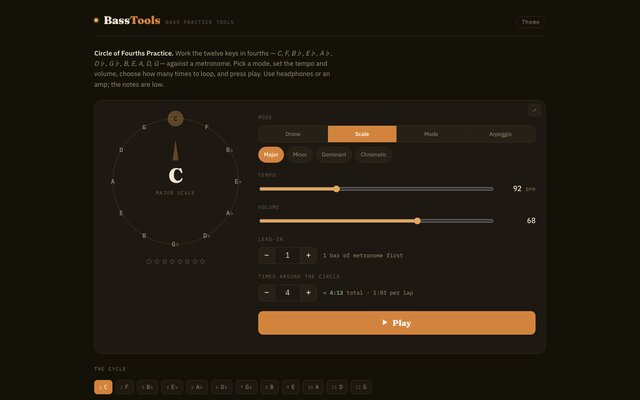
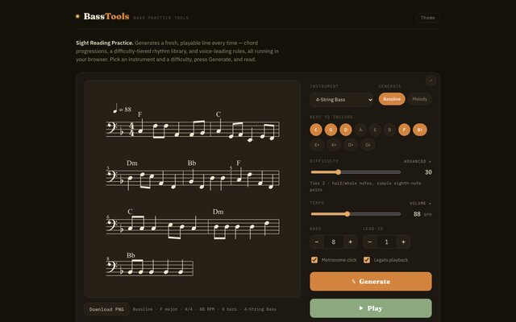
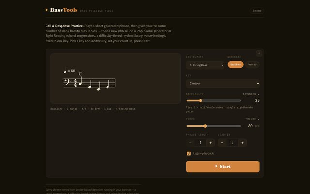

# BassTools

A few little tools I made to help me practice bass. They run entirely in your browser,
so there's nothing to install and nothing gets recorded or sent anywhere.

You can use them at [catchouli.github.io/BassTools](https://catchouli.github.io/BassTools/).

## What's in it

**Circle of Fourths** loops you around all twelve keys in fourths against a metronome.
You can have it play a drone, scales, modes or arpeggios, and set the tempo and how many
laps you want to do.

**Sight Reading** generates a new line to read every time you press the button, in bass
or treble clef. It builds them from chord progressions so they actually sound like
basslines, and there's a difficulty slider that goes from whole notes up to some fairly
busy stuff. It can play along with you, and you can save it as a PNG if you want to print
it out.

**Call & Response** is for ear training. It plays you a short phrase, then gives you the
same number of empty bars to play it back, then moves on to a new one, and keeps going
until you stop it. It uses the same generator as Sight Reading but sticks to one key.

## Running it locally

It's just static HTML files, so you can open `index.html` in a browser. If anything's
fussy about loading from `file://`, run `python3 -m http.server` in the folder and go to
`localhost:8000` instead.
